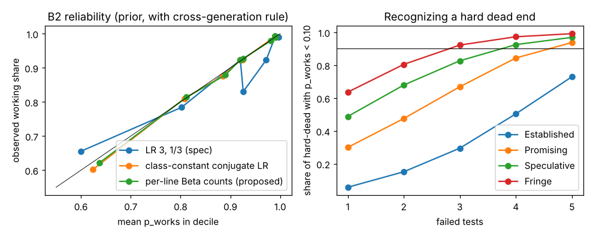
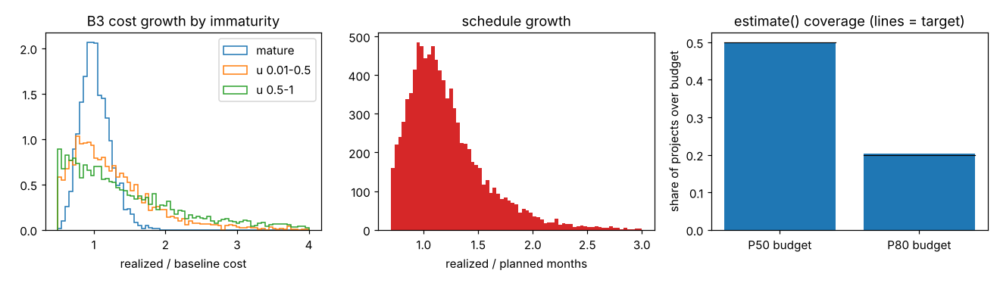

# M2(b) results: B1 truth, B2-lite beliefs, B3 growth (spec v0.3)

Generated by `python report.py` (seeds (101, 202, 303), 10,000 worlds for B1 and B3 projects, 200 worlds for B2). Synthetic content: 95 lines (incl. 20 singletons), 300 techs, 46 historical.

## Pass / fail by seed

| Seed | Req | Metric | Value | Criterion | Pass |
|---|---|---|---|---|---|
| 101 | RND-004 | max class-share error (pp) | 0.119 | < 1.5 | PASS |
| 101 | RND-006 | hard / soft per world | 20.1 / 51.0 | within 3 SE of content; soft/hard >= 2 | PASS |
| 101 | RND-008 | worlds x lines with sum g > 2 g0 (1-d^L)/(1-d) | 0.0e+00 | 0 | PASS |
| 101 | RND-012 | interval coverage min..max over stages | 0.797..0.803 | 0.77..0.83 | PASS |
| 101 | RND-012 | p_works reliability max dev, prior (pp), per-line counts | 1.531 | < 5 | PASS |
| 101 | v0.2 cmp | same, class-constant conjugate LR | 2.203 | < 5 | INFO |
| 101 | v0.2 cmp | same, LR 3 and 1/3 (v0.2 heuristic) | 9.572 | < 5 | INFO |
| 101 | v0.2 cmp | p_works in [0.2, 0.9) after dev: gap (pp) / n, gate events ignored (v0.2) | 29.2 / 661 | < 5, n >= 30 | INFO |
| 101 | RND-012 | same, gate events are evidence (v0.3) | n/a: n = 2 < 30, bin empty | < 5, n >= 30 | N/A |
| 101 | RND-011 | max |posterior - exact| over 15 cases | 0.000 | < 1e-6 | PASS |
| 101 | RND-005 | mean edges / sum p / sum p*P(valid) | 10.0 / 17.9 / 10.1 | mean within 3 SE of sum p*P(valid) | PASS |
| 101 | RND-038 | estimate(): P50 / P80 exceedance range over 20 stream seeds, plain / LHS / Sobol (committed set is Sobol seed 0) | plain 0.44-0.58 / 0.17-0.28; lhs 0.48-0.54 / 0.18-0.22; sobol 0.49-0.51 / 0.20-0.21 | 0.50±.05 / 0.20±.04 | INFO |
| 101 | RND-013 | hard-dead below 0.10 after 2 / 4 / 5 failed tests; by class after 2 | 0.63 / 0.89 / 0.95; [0.15 0.48 0.68 0.81] | [D] >= 0.80 after 4; Fringe >= 0.70 after 2 | PASS |
| 101 | RND-013 | median perf sigma ratio: science / after dev | 0.71 / 0.33 | <= 0.80 / <= 0.45 | PASS |
| 101 | RND-033 | mean u=0 / u>0 / all | 1.025 / 1.351 / 1.298 | 1.03±.03 / 1.35±.05 / 1.25..1.40 | PASS |
| 101 | RND-033 | CV (cost) / mean schedule | 0.777 / 1.189 | 0.80±0.10 / 1.10..1.30 | PASS |
| 101 | RND-038 | exceed P80 / P50 | 0.202 / 0.499 | 0.20±.04 / 0.50±.05 | PASS |
| 101 | §4.5.4 | share with final CPI > 10% off CPI at 20%: v0.3 0.5/0.3/0.2 vs v0.2 0.6/0.25/0.15 | 0.39 vs 0.66 | report; tune if most (> 0.5) | PASS |
| 202 | RND-004 | max class-share error (pp) | 0.286 | < 1.5 | PASS |
| 202 | RND-006 | hard / soft per world | 20.1 / 51.0 | within 3 SE of content; soft/hard >= 2 | PASS |
| 202 | RND-008 | worlds x lines with sum g > 2 g0 (1-d^L)/(1-d) | 0.0e+00 | 0 | PASS |
| 202 | RND-012 | interval coverage min..max over stages | 0.797..0.803 | 0.77..0.83 | PASS |
| 202 | RND-012 | p_works reliability max dev, prior (pp), per-line counts | 2.254 | < 5 | PASS |
| 202 | v0.2 cmp | same, class-constant conjugate LR | 1.442 | < 5 | INFO |
| 202 | v0.2 cmp | same, LR 3 and 1/3 (v0.2 heuristic) | 10.527 | < 5 | INFO |
| 202 | v0.2 cmp | p_works in [0.2, 0.9) after dev: gap (pp) / n, gate events ignored (v0.2) | 28.9 / 738 | < 5, n >= 30 | INFO |
| 202 | RND-012 | same, gate events are evidence (v0.3) | n/a: n = 2 < 30, bin empty | < 5, n >= 30 | N/A |
| 202 | RND-011 | max |posterior - exact| over 15 cases | 0.000 | < 1e-6 | PASS |
| 202 | RND-005 | mean edges / sum p / sum p*P(valid) | 10.0 / 17.9 / 10.1 | mean within 3 SE of sum p*P(valid) | PASS |
| 202 | RND-038 | estimate(): P50 / P80 exceedance range over 20 stream seeds, plain / LHS / Sobol (committed set is Sobol seed 0) | plain 0.44-0.58 / 0.17-0.28; lhs 0.48-0.54 / 0.18-0.22; sobol 0.49-0.51 / 0.20-0.21 | 0.50±.05 / 0.20±.04 | INFO |
| 202 | RND-013 | hard-dead below 0.10 after 2 / 4 / 5 failed tests; by class after 2 | 0.62 / 0.89 / 0.95; [0.2  0.49 0.68 0.81] | [D] >= 0.80 after 4; Fringe >= 0.70 after 2 | PASS |
| 202 | RND-013 | median perf sigma ratio: science / after dev | 0.71 / 0.33 | <= 0.80 / <= 0.45 | PASS |
| 202 | RND-033 | mean u=0 / u>0 / all | 1.029 / 1.342 / 1.292 | 1.03±.03 / 1.35±.05 / 1.25..1.40 | PASS |
| 202 | RND-033 | CV (cost) / mean schedule | 0.763 / 1.180 | 0.80±0.10 / 1.10..1.30 | PASS |
| 202 | RND-038 | exceed P80 / P50 | 0.197 / 0.491 | 0.20±.04 / 0.50±.05 | PASS |
| 202 | §4.5.4 | share with final CPI > 10% off CPI at 20%: v0.3 0.5/0.3/0.2 vs v0.2 0.6/0.25/0.15 | 0.39 vs 0.65 | report; tune if most (> 0.5) | PASS |
| 303 | RND-004 | max class-share error (pp) | 0.141 | < 1.5 | PASS |
| 303 | RND-006 | hard / soft per world | 20.1 / 51.1 | within 3 SE of content; soft/hard >= 2 | PASS |
| 303 | RND-008 | worlds x lines with sum g > 2 g0 (1-d^L)/(1-d) | 0.0e+00 | 0 | PASS |
| 303 | RND-012 | interval coverage min..max over stages | 0.800..0.805 | 0.77..0.83 | PASS |
| 303 | RND-012 | p_works reliability max dev, prior (pp), per-line counts | 1.613 | < 5 | PASS |
| 303 | v0.2 cmp | same, class-constant conjugate LR | 2.031 | < 5 | INFO |
| 303 | v0.2 cmp | same, LR 3 and 1/3 (v0.2 heuristic) | 8.492 | < 5 | INFO |
| 303 | v0.2 cmp | p_works in [0.2, 0.9) after dev: gap (pp) / n, gate events ignored (v0.2) | 28.8 / 668 | < 5, n >= 30 | INFO |
| 303 | RND-012 | same, gate events are evidence (v0.3) | n/a: n = 3 < 30, bin empty | < 5, n >= 30 | N/A |
| 303 | RND-011 | max |posterior - exact| over 15 cases | 0.000 | < 1e-6 | PASS |
| 303 | RND-005 | mean edges / sum p / sum p*P(valid) | 10.1 / 17.9 / 10.1 | mean within 3 SE of sum p*P(valid) | PASS |
| 303 | RND-038 | estimate(): P50 / P80 exceedance range over 20 stream seeds, plain / LHS / Sobol (committed set is Sobol seed 0) | plain 0.44-0.58 / 0.17-0.28; lhs 0.48-0.54 / 0.18-0.22; sobol 0.49-0.51 / 0.20-0.21 | 0.50±.05 / 0.20±.04 | INFO |
| 303 | RND-013 | hard-dead below 0.10 after 2 / 4 / 5 failed tests; by class after 2 | 0.63 / 0.89 / 0.95; [0.14 0.49 0.66 0.83] | [D] >= 0.80 after 4; Fringe >= 0.70 after 2 | PASS |
| 303 | RND-013 | median perf sigma ratio: science / after dev | 0.71 / 0.33 | <= 0.80 / <= 0.45 | PASS |
| 303 | RND-033 | mean u=0 / u>0 / all | 1.031 / 1.353 / 1.302 | 1.03±.03 / 1.35±.05 / 1.25..1.40 | PASS |
| 303 | RND-033 | CV (cost) / mean schedule | 0.740 / 1.185 | 0.80±0.10 / 1.10..1.30 | PASS |
| 303 | RND-038 | exceed P80 / P50 | 0.202 / 0.500 | 0.20±.04 / 0.50±.05 | PASS |
| 303 | §4.5.4 | share with final CPI > 10% off CPI at 20%: v0.3 0.5/0.3/0.2 vs v0.2 0.6/0.25/0.15 | 0.39 vs 0.65 | report; tune if most (> 0.5) | PASS |

## Figures

## Findings S-1–S-8 (applied in WS-05 v0.3, approved by Sean 2026-11-28; S-3 option (a))

Rows marked INFO above compare the v0.2 rules. The table below is kept as the record of why each v0.3 change was made.

Revised 2026-11-28 after the WS-10 review: S-1 adds the LHS comparison, S-2 adds per-line counts, S-4 is withdrawn and replaced (fixed clip 2.0), S-6 gets margin and a [D] framing, S-7 gets its tag. WS-10's S-3 option (b) (gating independent of `works`) was not tested; it changes the §0 taxonomy and RND-006 expectations.

Every finding below has a computed row in the table above (seeds 101/202/303) except S-8, which is a documentation point. The `xfail(strict)` tests in `test_rnd.py` (RND-005 as specified, RND-008, RND-012 for S-2 and S-3 (the fixture uses the counts rule), RND-013, RND-038 plain stream) turn green when the matching edit lands. The `b2` fixture and the passing RND-012 tests assume S-2 and S-3: **RND-012 passes with S-2 and S-3 applied and fails as specified.**

| ID | Spec location | Finding | Proposed edit |
|---|---|---|---|
| S-1 | §4.5.7, RND-038 | `estimate()` on 256 plain random draws reuses one noisy stream for every project. Over 20 stream seeds, P50 budgets were exceeded by 44–58% of projects and P80 budgets by 17–28%; 9 of 20 seeds fail RND-038 (targets 50 ± 5, 20 ± 4). A 256-point Latin hypercube gives 48–54% / 18–22% (0 of 20 fail); a scrambled Sobol set gives 49–51% / 20–21% (0 of 20 fail). WS-02 §3.1 rules out a Sobol crate in sim-core. | Use a **committed 256 × 3 Sobol point set** in `content/core/rnd/estimate_points.ron`, generated offline by a prototype script (768 numbers; 2–3× tighter than LHS, so it survives retuning of the growth constants). Fallback: Latin hypercube on a fixed ChaCha8 key (≈ 10 lines of Rust, no data file). Both are tested over 20 seeds (`rnd_038_estimate_s1_candidates_pass_20_seeds`). |
| S-2 | §4.2.5, RND-012, RND-016 | The fixed cross-generation LRs (3 and 1/3) overstate the evidence from a line's history: `p_works` reliability error 8.5–10.5 pp (limit 5). Two exact alternatives tested at seeds 101/202/303: class-constant conjugate LRs from the immediately previous generation (1.4–2.2 pp) and **per-line Beta counts**, prior for generation k = (α + s)/(α + β + s + f) with s proven and f declared-dead earlier generations (1.5–2.3 pp). Both pass; counts are exact for any history (a constant LR is exact only for the first observation). | Replace §4.2.5's heuristic with the counts rule: generation k's viability prior is set from the line's (s, f) when it becomes known. RND-016 changes to "prior equals (α+s)/(α+β+s+f) to 1e-12". The prototype defaults to counts. Consequence for design: line history barely moves Established and Promising lines (α ≥ 23). |
| S-3 | §0 (gates paragraph), §4.4, RND-023 | The spec says a gate finding must not be viability evidence, because it would break calibration. The reverse holds: a `Blocked` or `FeasibilityFinding` event can only occur for a tech that works (hard-dead techs are never gated). With the events ignored, techs at `p_works` ∈ [0.2, 0.9) after development (about 1,000 of 77,000 samples) worked 99.9% of the time against a mean `p_works` of 0.72. Treating the event as proof (ln LR = ln 10⁴, as for an acceptance pass) removes the gap. | `Blocked` and `FeasibilityFinding` push viability evidence ln LR = ln 10⁴. The UI reads "not a dead end; needs <field>". RND-023 changes to "viability belief jumps to ≥ 0.999". |
| S-4 | §4.1.4, RND-008 | Σ g_k ≤ g0/(1 − d) does not hold, because the LogNormal(mean 1, CV 0.3) multiplier is unbounded: 2.5–5.0 × 10⁻⁵ of world-lines exceed it (max 0.611 vs 0.600). The clip that would keep that exact bound is 1/(1 − d^L), which depends on the line: 1.27 for d = 0.95 (mean multiplier 0.962), 1.13 for d = 0.93 (0.930), 1.04 for d = 0.90 (0.902). Since §6.2's example uses d = 0.93, the original S-4 (clip 1.27) is withdrawn. | Clip every multiplier at a fixed m_max = 2.0 [D] and restate the bound as Σ g_k ≤ 2 · g0 (1 − d^L)/(1 − d). P(clip) = 0.6%, mean multiplier 0.999, so **g0 is not renormalized**. |
| S-5 | §4.1.2, RND-005 | An edge needs a source generation dated no later than the target, so the expected count is Σ p·P(valid), not Σ p. Here: 10.0 per world against Σ p = 16.5 (95 lines). The spec's "≈ 11 per world" is Σ p for 75 lines (0.002 × 75 × 74), so it is not the valid count. The prototype's `domain` stand-in for "different fields" also removes same-domain pairs, which lowers the count further (Σ p·P(valid) over different-domain pairs = 10.1). | RND-005 compares the mean edge count with Σ p·P(valid) over different-field pairs, computed from content, and the "≈ 11" is dropped. |
| S-6 | RND-013 (third clause) | After 2 failed tests only 62–63% of hard dead ends have `p_works` < 0.10 (Established 15%, Promising 47%, Speculative 68%, Fringe 80–83%); after 4: 89%; after 5: 95%. Rerun with the S-2 counts rule: unchanged within 1 pp. Strong priors and a failure LR of 1/3 make a dead Established tech hard to recognize. | Keep the model; restate the criterion as a **[D] design intent** ("a dead Established tech is meant to be hard to recognize; that is the sunk-cost lesson") with margin below the observed values: ≥ 80% after 4 failed tests at u = 2/3 (observed 89%), and Fringe ≥ 70% after 2 (observed 80–83%). B4 sets the AI's `θ_kill`. |
| S-7 | §4.5.4 | Variance shares 0.6/0.25/0.15 leave 66% of projects with a final CPI more than 10% from CPI at 20% (the [R] stability rule). 0.5/0.30/0.20 leaves 39%, with growth still front-loaded (phase cost rates 1.37, 1.30, 1.20). `params.py` already uses it. | Change the shares to (0.5, 0.30, 0.20), tagged **[D] tuned M2(b)**. |
| S-8 | §4.5.3, §7 | The spec cites `calib_growth.py` for the fit, but that script still uses the v0.1 targets and clamps u at 1. `b3_growth` now is the reference: with the spec constants and the belief σ the simulation produces, no refit was needed (cost growth 1.03 / 1.34–1.35 / 1.29–1.30, CV 0.75–0.78, schedule 1.19). | Cite `scenarios.b3_growth`; keep `calib_growth.py` only for the RND-011 check (or retire it). |

## Test coverage gaps (NOT covered by `test_rnd.py`)

- RND-005: "adding a line changes no edge" is tested only on the pair hash, not by calling `sample_edges` on content with an added line.
- RND-007: no content validator exists yet, so cycle rejection of a cyclic fixture is untested (acyclicity of generated content is asserted); the "added unnamed line leaves gates bit-identical" test needs content-edit support in `content_gen.py`.
- RND-008: only the gain-bound clause. Levels always working, never gated, level k+1 known after proof, the effort formula and gain application need the project loop (B2 full).
- RND-012 and RND-013 use per-stage beliefs on every tech, not 6 polities × quarters or cumulative-effort deciles; the interval-coverage check is close to tautological because truth and prior share one model. The real tests are B2 full.
- RND-004 runs at 4,000 worlds in pytest and 10,000 in `report.py`.

## Not yet done (M2(b) is partly complete)

- **B2 full** (1955–2060 time loop with `science.py`, the project loop, observing others, publication and espionage) and so the decade fans; B2-lite above shows the same belief mechanics per stage on every tech.
- **B4** (kill-threshold ROC, `M_pause`), **B5** (portfolio, RND-104), **B6–B9** (production, market, spec churn, contracting).
- Cross-line prerequisites, discovery and hidden-tech hazard are not in the synthetic content yet; B2-lite treats every tech as already known.
- RND-012's decile test is run at the prior and after-development stages only; the all-quarter version needs B2 full.